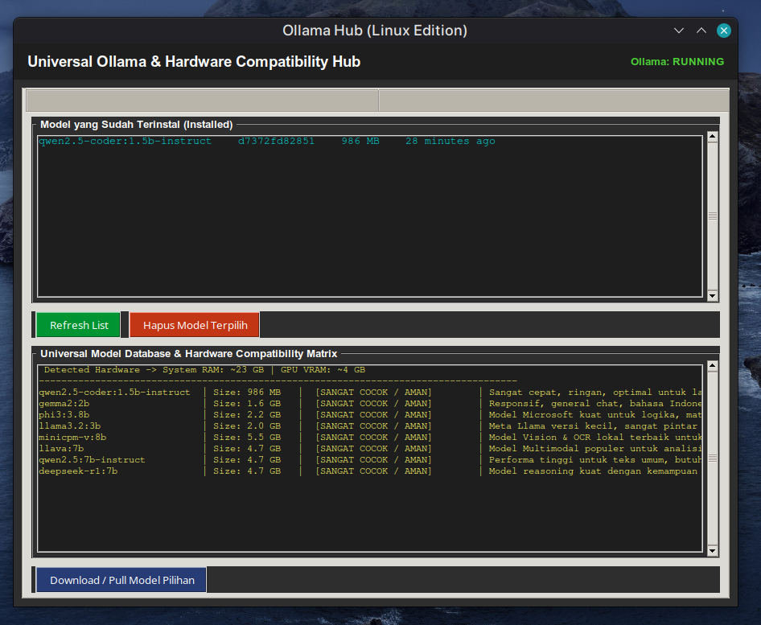

# Ollama Manager (Linux Edition)

A lightweight desktop application built with Python and Tkinter, specifically designed for Linux users to manage the **Ollama** server, monitor hardware specifications (System RAM & GPU VRAM), and select or download optimal LLM models based on hardware compatibility.

---

## 🖼️ Application Preview



---

## 🚀 Key Features

1. **Hardware Matrix & Compatibility Evaluator**:
   - Automatically detects total system RAM (via `/proc/meminfo`) and NVIDIA GPU VRAM capacity (`nvidia-smi`).
   - Matches device specs against a curated database of AI models and provides real-time compatibility statuses (`[SANGAT COCOK / AMAN]`, `[BISA TAPI BERAT / CPU]`, or `[TIDAK DISARANKAN]`).
2. **Model Management (Installed & Pull/Delete)**:
   - View a live list of locally installed AI models.
   - Download (`pull`) new models directly from the recommendation matrix with background thread execution to prevent GUI freezing.
   - Remove (`rm`) unused models to reclaim disk space.
3. **API & Integration Hub**:
   - Provides local endpoint references (`http://localhost:11434` and OpenAI compatible `/v1`) for integration with Hermes Agent or other Web UIs.
   - Includes a *Ping API* check to verify server connectivity.
4. **Terminal Guide & Quick Start**:
   - Built-in quick reference guide for common Ollama terminal operations.

---

## 📋 System Prerequisites

- Operating System: **Linux** (Ubuntu, Debian, Fedora, Arch, etc.)
- **Python 3** with standard `tkinter` package enabled.
- **Ollama** installed on the system (`curl -fsSL https://ollama.com/install.sh | sh`).
- *(Optional)* NVIDIA GPU drivers and `nvidia-smi` for automatic VRAM detection.

---

## 🛠️ Installation & Usage

1. **Clone or Place Repository**:
   Navigate to your local `ollama-manager` directory.

2. **Run the Automated Installation Script**:
   The `install.sh` script dynamically detects your absolute path and registers the application to your Linux application launcher:
   ```bash
   chmod +x install.sh
   ./install.sh
   ```

3. **Run Manually**:
   To launch the application directly from your terminal:
   ```bash
   python3 ollama_manager.py
   ```

---

## 📁 Project Structure

- `ollama_manager.py`: Main Python GUI application and backend logic script.
- `models_db.json`: Local database storing model specifications, file sizes, and hardware thresholds.
- `ollama-manager.desktop`: Linux desktop launcher configuration file.
- `install.sh`: Automated installer script for setting up system shortcuts.
- `screenshot.png`: Application interface preview image.
- `README.md`: Project documentation and user guide.
