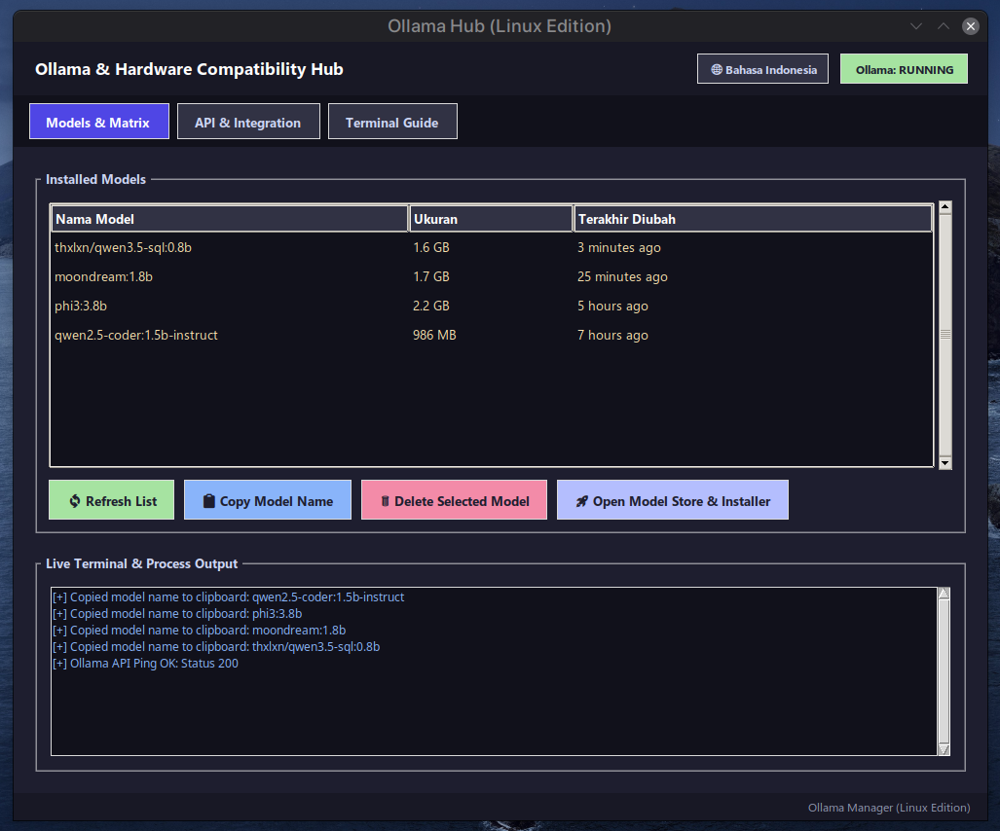

# Ollama Manager (Linux Edition)

A lightweight, modern desktop application built with Python and Tkinter, specifically designed for Linux users to manage the **Ollama** server, monitor hardware specifications (System RAM & GPU VRAM), and select or download optimal LLM models based on hardware compatibility with multi-language support (Bahasa Indonesia & English).

---

## 🖼️ Application Preview



---

## 🚀 Key Features

1. **Hardware Matrix & Compatibility Evaluator**:
   - Automatically detects total system RAM (via `/proc/meminfo`) and NVIDIA GPU VRAM capacity (`nvidia-smi`).
   - Matches device specs against a curated database of AI models and provides real-time compatibility statuses (`[SANGAT COCOK / FAST]`, `[COCOK / CPU BOUND]`, `[BERAT / LOW RAM]`, or `[TIDAK DISARANKAN]`).
2. **Model Management (Installed & Pull/Delete/Store)**:
   - View a live list of locally installed AI models using a clean, modern Treeview interface with size and modification timestamp columns.
   - Copy model names to the clipboard instantly with a single click.
   - Dedicated **Model Store & Universal Installer modal** with multi-column hardware compatibility assessment, live download log output, and threaded execution to prevent GUI freezing.
   - Remove (`rm`) unused models safely with confirmation prompts.
3. **Server Control & Status Management**:
   - Real-time indicator for Ollama server status (`RUNNING`, `STOPPED`, or `NOT INSTALLED`).
   - One-click server control using `pkexec systemctl start/stop ollama` with Linux GUI password prompt integration.
4. **API & Integration Hub**:
   - Provides local endpoint references (`http://localhost:11434` and OpenAI-compatible `/v1`) for seamless integration with Hermes Agent, Web UIs, or local tools.
   - Built-in *Ping API* check to verify server responsiveness.
5. **Multi-Language Support**:
   - Fully toggleable between Bahasa Indonesia and English interface on the fly.
6. **Linux Terminal Guide & Quick Start**:
   - Built-in quick reference guide for common Ollama terminal operations and agent setup.

---

## 📋 System Prerequisites

- Operating System: **Linux** (Ubuntu, Debian, Fedora, Arch, Linux Mint, etc.)
- **Python 3** with standard `tkinter` package enabled.
- **Ollama** installed on the system (`curl -fsSL https://ollama.com/install.sh | sh`).
- *(Optional)* NVIDIA GPU drivers and `nvidia-smi` for automatic VRAM detection.

---

## 🛠️ Installation & Usage

1. **Clone or Navigate to the Repository**:
   ```bash
   cd /home/ansori/Projects/app-linux/ollama-manager-linux
   ```

2. **Run the Automated Installation Script**:
   The `install.sh` script dynamically detects your absolute path and registers the application to your Linux application launcher:
   ```bash
   chmod +x install.sh
   ./install.sh
   ```

3. **Run Manually**:
   To launch the application directly from your terminal:
   ```bash
   python3 ollama_manager.py
   ```

---

## 📁 Project Structure

- `ollama_manager.py`: Main Python GUI application, multi-language controller, and backend logic script.
- `models_db.json`: Local database storing model specifications, file sizes, and hardware thresholds.
- `install.sh`: Automated installer script for setting up system shortcuts and `.desktop` launchers.
- `preview.png`: Application interface preview image.
- `README.md`: Project documentation and user guide.
