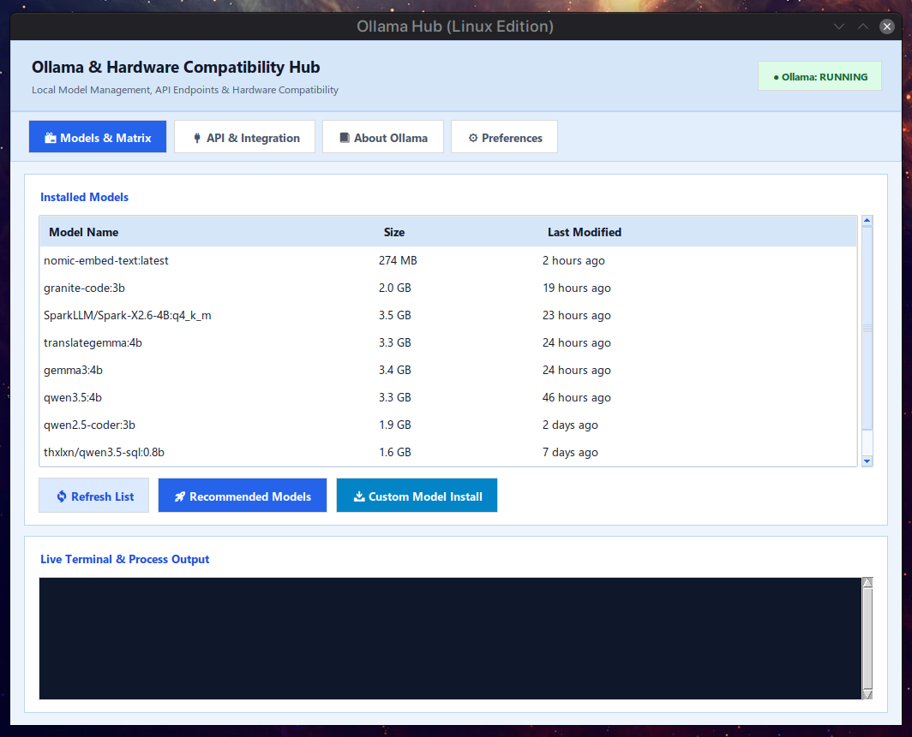
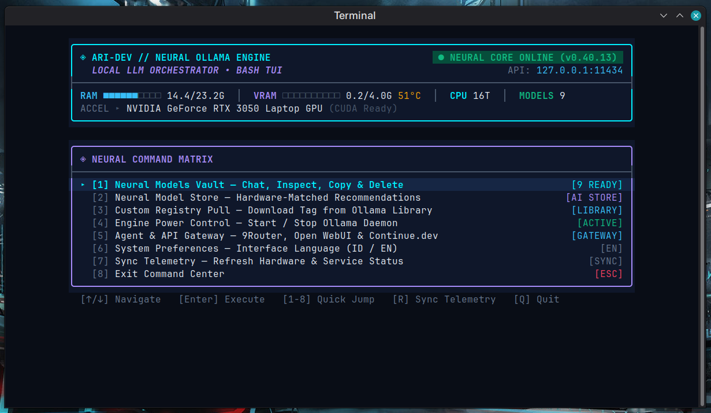

# Ollama Manager (Linux Edition)

A comprehensive local AI management suite built specifically for Linux users, featuring both a modern **Python/Tkinter GUI (`ollama_manager.py`)** and a high-performance **Zero-Flicker Bash TUI (`ollama-manager-tui.sh`)**. It allows you to manage the **Ollama** server, monitor hardware specifications (System RAM & GPU VRAM in real-time), select and download optimal LLM models based on hardware compatibility, run streaming chats with code-block clipboard copy support, and configure local AI agent integrations (Continue.dev, Open WebUI, 9Router, etc.) with multi-language support (Bahasa Indonesia & English).

---

## 🖼️ Application Previews

### Graphical User Interface (GUI)


### Terminal User Interface (TUI)


---

## 🚀 Key Features

### 1. Dual Interface Ecosystem (`GUI` & `TUI`)
- **Python GUI (`ollama_manager.py`)**: Modern, soft-blue themed desktop interface with tabbed navigation, Treeview model tables, right-click context menus, and threaded workers.
- **Bash TUI (`ollama-manager-tui.sh`)**: Zero-flicker 24-bit TrueColor cyber-neural terminal user interface designed for remote SSH or terminal-first workflows with live hardware telemetry.

### 2. Hardware Matrix & Compatibility Evaluator
- Automatically detects total system RAM (via `/proc/meminfo`) and NVIDIA GPU VRAM capacity (`nvidia-smi`), along with CPU thread counts and GPU temperatures.
- Matches device specs against a curated database of AI models (`models_db.json`) and provides real-time compatibility statuses (`[SANGAT COCOK / OPTIMAL]`, `[COCOK / COMPATIBLE]`, or `[BERAT / HEAVY]`).

### 3. Model Management & Store (`Installed` & `Pull/Delete/Inspect`)
- **Installed Vault**: View a live list of locally installed AI models with size and modification timestamps. Supports right-click/hotkey actions to copy model tags, inspect model architecture (`ollama show`), delete unused models (`ollama rm`), or open interactive chat sessions.
- **Model Store**: Curated store with multi-column hardware compatibility assessments and category filters (`Coding`, `Reasoning`, `Vision`, `General`).
- **Custom Registry Pull**: Direct input prompt to download any tag from the official Ollama library (`ollama pull`).

### 4. Interactive Neural Streaming Chat
- Run interactive CLI chat sessions with local models featuring real-time token streaming, performance statistics (`tok/s` and latency), and markdown rendering.
- Built-in command helpers: `/copy [n]` to copy specific code blocks directly to the clipboard (`xclip` / `wl-copy`), `/last` to copy the entire last AI response, `/clear` to reset context, and `/exit`.

### 5. Server Control & Status Management
- Real-time indicator for Ollama server status (`RUNNING`, `STOPPED`, or `NOT INSTALLED`).
- One-click server control using `pkexec systemctl start/stop ollama` with Linux GUI password prompt integration or fallback daemon startup (`ollama serve`).

### 6. API & Integration Hub
- Provides local endpoint references (`http://localhost:11434` and OpenAI-compatible `/v1`) for seamless integration with Continue.dev, Open WebUI (Docker), 9Router, and Aider CLI.
- Built-in *Ping API* check to verify server responsiveness (HTTP 200) and one-click copy for `~/.continue/config.yaml`.

### 7. Multi-Language Support & Preferences
- Fully toggleable between **Bahasa Indonesia (ID)** and **English (EN)** on the fly with persistent settings saved to `config.json`.

---

## 📋 System Prerequisites

- Operating System: **Linux** (Ubuntu, Debian, Fedora, Arch, Linux Mint, openSUSE, etc.)
- **Python 3** with standard `tkinter` package enabled (for GUI).
- **Bash** and core utilities (`curl`, `awk`, `sed`, `grep`, `bc`, `jq`, `xclip`/`wl-copy`).
- **Ollama** installed on the system (`curl -fsSL https://ollama.com/install.sh | sh`).
- *(Optional)* NVIDIA GPU drivers and `nvidia-smi` for automatic VRAM detection.

---

## 🛠️ Installation & Usage

1. **Clone or Navigate to the Repository**:
   ```bash
   cd /home/Projects/app-linux/ollama-manager-linux
   ```

2. **Run the Automated Installation Script**:
   The `install.sh` script dynamically detects your absolute path, checks/installs dependencies, and registers both GUI (`ollama-manager.desktop`) and TUI (`ollama-manager-tui.desktop`) shortcuts to your Linux application launcher:
   ```bash
   chmod +x install.sh
   ./install.sh
   ```

3. **Run Manually**:
   - **Launch GUI**:
     ```bash
     python3 ollama_manager.py
     ```
   - **Launch TUI**:
     ```bash
     ./ollama-manager-tui.sh
     ```

---

## 📁 Project Structure

- `ollama_manager.py`: Main Python GUI application, multi-language controller, and backend logic script.
- `ollama-manager-tui.sh`: High-performance Bash TUI script with double-buffered rendering and truecolor cyber-neural interface.
- `models_db.json`: Local database storing model specifications, file sizes, and hardware compatibility thresholds.
- `config.json`: Persistent user preferences (interface language, terminal emulator).
- `install.sh`: Automated installer script for setting up system shortcuts and `.desktop` launchers.
- `preview.png`: GUI application interface preview image.
- `preview_tui.png`: TUI application interface preview image.
- `README.md`: Project documentation and user guide.
